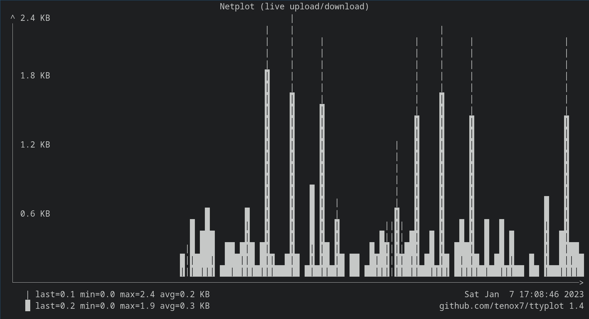

# Netplot 📈

Netplot displays network upload and download in plot form inside the terminal.

<p align="center">
  
</p>

## Dependencies

`netplot` is dependent on three packages `ttyplot`, `fzf` and `pcre` (for `pcregrep`). Install them by running,

```bash
$ doas pkg_add ttyplot fzf pcre
```

## Installation

```bash
$ curl -sL https://raw.githubusercontent.com/OpenBSDGuy/netplot/master/netplot > "$HOME/.local/bin/netplot" && chmod a+x "$HOME/.local/bin/netplot" 
```

## Uninstallation

```bash
$ rm "$HOME/.local/bin/netplot" && doas pkg_delete ttyplot fzf pcre
```
